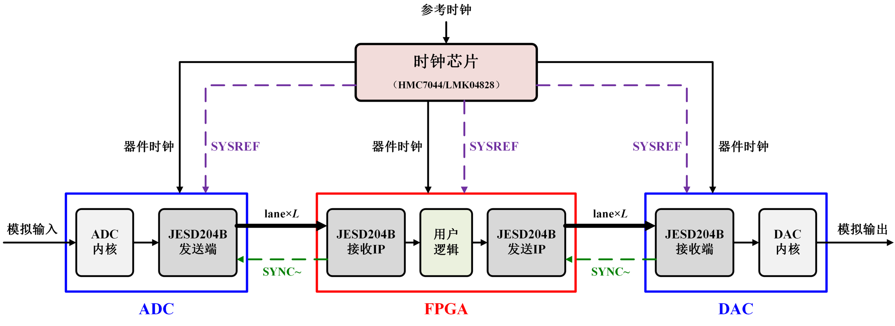

# visio-sci-figure

用于 Claude Code 等 AI 编程助手的 skill。它按统一的科研论文插图风格，调用 Visio COM 自动绘制可编辑的 `.vsdx` 工程，并导出高分辨率 PNG。适用于系统框图、硬件架构图、模块结构图等插图。



## 风格

- 英文用 Times New Roman，中文用宋体，文字全部加粗；变量用加粗斜体，支持上下标。
- 先在大画布上绘制，线宽 2~2.5 pt，字号 13~18 pt，插入 Word 时再缩小到版心宽度。
- 模块用灰阶填充，配少量浅粉、浅蓝、浅绿作强调；存储器类模块用深灰底白字。
- 功能分区用蓝色或红色粗框，区名放在框下方；子模块组用彩色圆角虚线框。
- 箭头为实心三角，不同信号用颜色和线型区分；最终输出用红色块状箭头。

完整规范见 [SKILL.md](SKILL.md)。

## 环境要求

- Windows
- Microsoft Visio
- Python 3 与 `pywin32`

## 安装

```bash
npx skills add 1183029827/visio-sci-figure
```

也可以手动安装：把本仓库克隆到 `~/.claude/skills/visio-sci-figure`。

## 使用

在 Claude Code 中直接说"按科研绘图风格画一张 xxx 框图"，或者调用 `/visio-sci-figure`。

绘图库也可以单独使用：

```python
import sys
sys.path.insert(0, 'path/to/visio-sci-figure/scripts')
from vsd_style import Figure, C

with Figure(200, 80, 'out/demo') as f:          # 生成 out/demo.vsdx 和 out/demo.png
    f.region(10, 10, 90, 60, 'ADC', C.BLUE)
    f.box(15, 20, 45, 50, 'ADC\n内核', fill=C.GRAY1)
    f.box(55, 20, 85, 50, 'JESD204B\n发送端', fill=C.GRAY2)
    f.arrow([(45, 35), (55, 35)])
```

完整示例见 [examples/jesd204b_system.py](examples/jesd204b_system.py)。

## License

MIT
